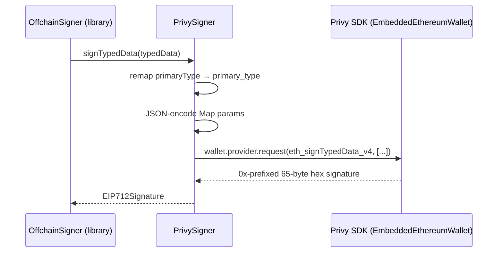
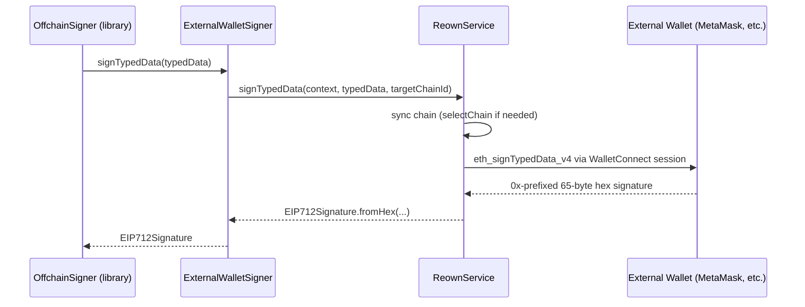

# Custom Wallet Signers

This document describes the design and implementation of the custom `Signer` subclasses used in this app. These classes bridge third-party wallet SDKs (Privy, Reown/WalletConnect) to the `Signer` interface defined by the `location_protocol` Dart library, enabling both offchain EIP-712 signing and onchain transaction dispatch without the library ever handling raw private keys.

## Background: The `Signer` Interface

The `location_protocol` library defines an abstract `Signer` class with two signing methods:

```dart
abstract class Signer {
  String get address;

  // Called by OffchainSigner when building an EIP-712 attestation.
  Future<EIP712Signature> signTypedData(Map<String, dynamic> typedData);

  // Called only by LocalKeySigner-style signers that operate on pre-hashed digests.
  Future<EIP712Signature> signDigest(Uint8List digest);
}
```

The key distinction for wallet-backed signers is:

- **`signTypedData`** receives the complete EIP-712 JSON (domain, types, message) and delegates hashing + signing to the wallet SDK. This is the correct path for any SDK-managed wallet.
- **`signDigest`** receives a pre-computed 32-byte hash. It is used by `LocalKeySigner` (raw private key path) and is **never called** by `OffchainSigner` when `signTypedData` is overridden.

Both `PrivySigner` and `ExternalWalletSigner` override only `signTypedData` and throw `UnsupportedError` from `signDigest` — explicitly documenting that the library never exercises that path for wallet-backed signers.

For background on the general pattern, see the upstream tutorial: [Sign attestations with an external wallet signer](https://github.com/DecentralizedGeo/location-protocol-dart/blob/main/doc/guides/tutorial-wallet-signer.md).

---

## `PrivySigner`

**File:** [lib/protocol/privy_signer.dart](../lib/protocol/privy_signer.dart)

`PrivySigner` bridges a [Privy](https://www.privy.io/) embedded wallet to the `Signer` interface.

### Design goals

1. **Testability without the Privy SDK.** Rather than accepting an `EmbeddedEthereumWallet` directly, `PrivySigner` accepts an `EthereumRpcCaller` callback — a plain `Future<String> Function(String method, List<dynamic> params)`. This decouples the class from the Privy SDK in tests.
2. **Single SDK touch point.** The `PrivySigner.fromWallet()` factory is the only location that references Privy types. Everything else works against the callback.
3. **Android SDK key remapping.** The Privy Flutter SDK (Android side) parses `primary_type` instead of the standard EIP-712 `primaryType`. `PrivySigner` rewrites the key before serializing to JSON for the RPC bridge.

### Class summary

```dart
typedef EthereumRpcCaller = Future<String> Function(
  String method,
  List<dynamic> params,
);

class PrivySigner extends Signer {
  final String _address;
  final EthereumRpcCaller _rpcCaller;

  // Test constructor — accepts any RpcCaller mock.
  PrivySigner({required String walletAddress, required EthereumRpcCaller rpcCaller});

  // Production constructor — wraps a real EmbeddedEthereumWallet.
  factory PrivySigner.fromWallet(EmbeddedEthereumWallet wallet);
}
```

### `signTypedData` implementation

```dart
@override
Future<EIP712Signature> signTypedData(Map<String, dynamic> typedData) async {
  // Remap primaryType → primary_type for Privy Android SDK compatibility.
  final remapped = Map<String, dynamic>.of(typedData);
  if (remapped.containsKey('primaryType')) {
    remapped['primary_type'] = remapped.remove('primaryType');
  }

  final sigHex = await rpcCall('eth_signTypedData_v4', [_address, remapped]);
  return EIP712Signature.fromHex(sigHex);
}
```

The `rpcCall` helper also JSON-encodes any `Map` entries in the params list. This is required because the Privy Android bridge expects nested objects to arrive as JSON strings rather than structured objects:

```dart
Future<String> rpcCall(String method, List<dynamic> params) {
  final encodedParams = params.map((p) {
    if (p is Map) return jsonEncode(p);
    return p;
  }).toList();
  return _rpcCaller(method, encodedParams);
}
```

### `fromWallet` factory

The factory wires a real `EmbeddedEthereumWallet` into the `EthereumRpcCaller` callback. It converts Privy's `fold`-style result type into either a resolved `String` or a thrown `PrivySigningException`:

```dart
factory PrivySigner.fromWallet(EmbeddedEthereumWallet wallet) {
  return PrivySigner(
    walletAddress: wallet.address,
    rpcCaller: (method, params) async {
      final result = await wallet.provider.request(
        EthereumRpcRequest(method: method, params: params),
      );
      late String data;
      result.fold(
        onSuccess: (r) => data = r.data,
        onFailure: (e) => throw PrivySigningException('RPC call failed: ${e.message}'),
      );
      return data;
    },
  );
}
```

### Signature flow diagram



---

## `ExternalWalletSigner`

**File:** [lib/protocol/external_wallet_signer.dart](../lib/protocol/external_wallet_signer.dart)

`ExternalWalletSigner` bridges external custodial wallets — such as MetaMask connected via Reown (WalletConnect) — to the `Signer` interface.

### Design goals

1. **Thin adapter.** The class holds only a wallet address and a callback. All Reown/WalletConnect SDK details live in `ReownService`, not here.
2. **UI-agnostic.** The `ExternalSignCallback` type lets the caller inject any signing flow — Reown modal, manual paste, or a mock — without coupling the signer to a specific UI framework.

### Class summary

```dart
typedef ExternalSignCallback = Future<EIP712Signature> Function(
  Map<String, dynamic> typedData,
);

class ExternalWalletSigner extends Signer {
  final String _address;
  final ExternalSignCallback _onSignTypedData;

  ExternalWalletSigner({
    required String walletAddress,
    required ExternalSignCallback onSignTypedData,
  });
}
```

### `signTypedData` implementation

The implementation is intentionally minimal — it delegates directly to the injected callback:

```dart
@override
Future<EIP712Signature> signTypedData(Map<String, dynamic> typedData) {
  return _onSignTypedData(typedData);
}
```

The callback is assembled in `AppWalletProvider.getSigner()` at the call site, where it closes over both the `ReownService` reference and the `targetChainId`:

```dart
return ExternalWalletSigner(
  walletAddress: address,
  onSignTypedData: (typedData) async {
    return reownService.signTypedData(
      context,
      typedData,
      targetChainId: 'eip155:$targetChainId',
    );
  },
);
```

### Signature flow diagram



---

## `ReownService` — Transaction and Signing Dispatch

**File:** [lib/services/reown_service.dart](../lib/services/reown_service.dart)

`ReownService` manages the WalletConnect session lifecycle and provides the actual `eth_signTypedData_v4` and `eth_sendTransaction` calls that `ExternalWalletSigner` (and `AppWalletProvider`) delegate to.

### Testability via `ReownModalAdapter`

Rather than directly referencing `ReownAppKitModal`, the service depends on an abstract `ReownModalAdapter` interface. In production the `ReownAppKitModalAdapter` wraps the real modal; in tests a mock can be injected:

```dart
abstract class ReownModalAdapter {
  bool get isConnected;
  String? get sessionChainId;
  String? get selectedChainId;
  String get sessionTopic;
  String get address;

  Future<void> openModalView();
  Future<void> selectChain(String chainId);
  Future<Object?> request({...});
}
```

### Chain synchronization

Before each request, `ReownService` compares the desired `targetChainId` against the current session chain and calls `selectChain()` if a switch is needed. This ensures the external wallet is always on the correct network before signing or sending:

```dart
Future<String> _syncChainForRequest(
  ReownModalAdapter modal, {
  String? targetChainId,
}) async {
  final desiredChainId = targetChainId ?? modal.selectedChainId;
  // If session is on a different chain, switch first.
  if (currentSessionChainId != null && currentSessionChainId != desiredChainId) {
    await modal.selectChain(desiredChainId);
  }
  return desiredChainId;
}
```

---

## `AppWalletProvider` — Unified Signer Factory

**File:** [lib/providers/app_wallet_provider.dart](../lib/providers/app_wallet_provider.dart)

`AppWalletProvider` is the single place in the app that decides which `Signer` subclass to instantiate. It exposes a `getSigner(context, targetChainId)` method that returns the correct implementation based on the active `ConnectionType`:

```
ConnectionType.privy       → PrivySigner.fromWallet(privyAuth.wallet)
ConnectionType.external    → ExternalWalletSigner(walletAddress, reownService.signTypedData)
ConnectionType.privateKey  → LocalKeySigner(privateKeyHex)   ← built-in library class
ConnectionType.none        → null
```

Transaction dispatch follows the same pattern via `sendTransaction()`:

```
ConnectionType.privy       → wallet.provider.request(eth_sendTransaction)
ConnectionType.external    → reownService.sendTransaction(context, txRequest, targetChainId)
ConnectionType.privateKey  → throws UnsupportedError (no on-chain path for raw keys)
```

The `chainId` from the `txRequest` map (as `0x`-prefixed hex) is decoded and forwarded to `ReownService` as an `eip155:<chainId>` namespace string, ensuring the external wallet switches to the correct chain before broadcasting.

---

## Comparison: `PrivySigner` vs `ExternalWalletSigner`

| | `PrivySigner` | `ExternalWalletSigner` |
|---|---|---|
| **Wallet type** | Privy embedded wallet | MetaMask / WalletConnect (via Reown) |
| **SDK entry point** | `wallet.provider.request(...)` | `ReownService.signTypedData(...)` |
| **Key remapping** | `primaryType` → `primary_type` | None needed |
| **Param encoding** | `Map` params JSON-encoded | Not required |
| **Chain selection** | Embedded wallet inherits app chain | `ReownService._syncChainForRequest()` |
| **Transaction support** | Via `AppWalletProvider.sendTransaction` → `wallet.provider` | Via `ReownService.sendTransaction()` |
| **Test strategy** | Inject `EthereumRpcCaller` mock | Inject `ExternalSignCallback` mock |
| **`signDigest`** | `throw UnsupportedError` | `throw UnsupportedError` |

---

## What the library calls (and what it never calls)

`OffchainSigner` from the library calls `signer.signTypedData()` with the complete EIP-712 typed data map. It **never** calls `signDigest()` when a wallet-backed signer is used. The `signDigest` path is exercised only by `LocalKeySigner` internally.

This means the two `throw UnsupportedError` stubs in `PrivySigner` and `ExternalWalletSigner` are not defensive guards — they are explicit contracts that prove the library's calling convention: if `signDigest` were ever invoked on a wallet-backed signer, it would surface immediately in tests rather than silently producing a wrong signature.
