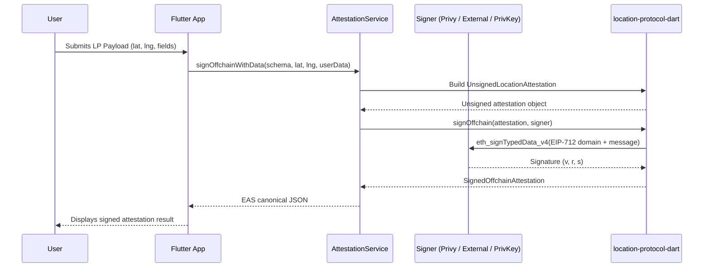
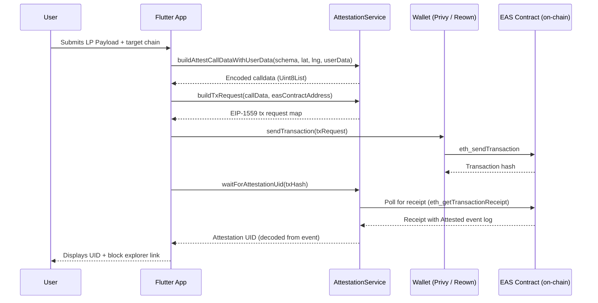

# Location Protocol Architecture & Implementation

This document provides a conceptual overview of the Location Protocol and details the architecture and implementation of this Flutter application.

## Overview

At its core, the [Location Protocol](https://spec.decentralizedgeo.org/introduction/overview/) is a signature service designed to guarantee the integrity and authorship of location records.

The primary goal of this application is to implement the capabilities of creating location attestations as defined by the [Astral SDK](https://github.com/DecentralizedGeo/astral-sdk). It achieves this by using the [Ethereum Attestation Service (EAS)](https://docs.attest.org/docs/purpose/attestation-ecosystem) as the underlying attestation infrastructure and supports both onchain and offchain EAS-compatible attestations across a wide range of EVM networks.

## Supported Capabilities

| Capability | Description |
|---|---|
| **Offchain Attestation** | Sign EIP-712 typed data attestations without any on-chain transaction |
| **Onchain Attestation** | Submit attestations directly to the EAS contract on any supported chain |
| **Offchain UID Timestamping** | Anchor an offchain attestation UID on-chain for proof of existence |
| **Offchain Verification** | Verify an EAS canonical JSON attestation and recover the signer address |
| **Schema Management** | Define custom schema fields, compute deterministic UIDs, and register schemas on-chain |

## Signing Methods

The app supports three distinct wallet/signing integrations, managed through a unified `AppWalletProvider` abstraction:

### 1. Privy Embedded Wallet
Users authenticate via email, SMS, Google, Twitter, or Discord. Privy automatically provisions an embedded Ethereum wallet. All signing is routed through `eth_signTypedData_v4` and `eth_sendTransaction` via the embedded wallet provider. The `PrivySigner` adapter bridges Privy's RPC interface to the protocol's `Signer` contract.

### 2. External Wallet via Reown (WalletConnect / MetaMask)
The `ReownService` integrates [Reown AppKit](https://docs.reown.com/appkit/overview) (formerly WalletConnect AppKit) to connect custodial wallets like MetaMask. EIP-712 typed data is presented through the Reown modal, and the resulting signature is captured by `ExternalWalletSigner`. Onchain transactions are dispatched via `ReownService.sendTransaction()`.

### 3. Imported Private Key
For development and testing, users may import a raw hex private key. The `AppWalletProvider` initializes a `LocalKeySigner` that performs all signing in-process. This path does not support sending transactions.

### Wallet Priority

When multiple wallet types are active, the following priority order applies:

```
Imported Private Key  >  External Wallet (Reown)  >  Privy Embedded Wallet
```

## Architecture and Signing Flows

### Offchain Attestation Flow



### Onchain Attestation Flow



## Provider & Service Layer

The app uses Flutter's `Provider` package for dependency injection. Key providers initialized at startup:

| Provider | Role |
|---|---|
| `PrivyAuthProvider` | Manages Privy authentication state and embedded wallet lifecycle |
| `ReownService` | Manages WalletConnect session and external wallet interactions |
| `AppWalletProvider` | Unified wallet abstraction — exposes `isConnected`, `canSendTransactions`, `getSigner()`, `sendTransaction()` |
| `SchemaProvider` | Manages the active schema definition, persists user customizations, computes schema UIDs |
| `AttestationServiceProvider` | Wraps `AttestationService` with the current network config and schema |

## Schema Management

Schemas follow a two-layer structure:

- **LP Base Fields** (automatically prepended by the library): `lp_version`, `srs`, `location_type`, `location`
- **App-Level Fields** (user-configurable): `uint256 eventTimestamp`, `string[] recipeType`, `bytes[] recipePayload`, `string[] mediaType`, `bytes[] mediaData`, `string memo`

Schema UIDs are computed deterministically from the schema string, resolver address, and revocability flag via `SchemaUID.compute()`. Users can add or remove app-level fields at runtime; changes are persisted to SharedPreferences.

Registered schemas can be queried via the EAS Scan GraphQL API (`EasScanService.queryUserSchemas()`), and registration status can be checked on-chain via `AttestationService.isSchemaUidRegistered()`.

## Multi-Chain Support

The target chain is selected in Settings. All supported chains are defined in `ChainConfig` from the `location-protocol-dart` library. The `RuntimeNetworkConfig` resolves the active chain's EAS contract address, Schema Registry address, and EAS version string at runtime. RPC connectivity is provided either by a manually entered URL or auto-generated via an Infura API key.

Supported networks span both mainnets and testnets including Ethereum, Optimism, Base, Arbitrum One, Arbitrum Nova, Polygon, Celo, Linea, Blast, Scroll, Unichain, Soneium, Ink, and their respective testnets (Sepolia, Optimism Sepolia, Base Sepolia, Arbitrum Sepolia, Polygon Amoy, Scroll Sepolia, Ink Sepolia).

## Default Attestation Field Values

When constructing attestation payloads, the following defaults are applied unless overridden:

| Field | Default Value |
|---|---|
| `revocable` | `true` |
| `expirationTime` | `0` (no expiration) |
| `refUID` | Zero bytes (`0x000...000`) |
| `recipient` | Zero address (`0x000...000`) |
